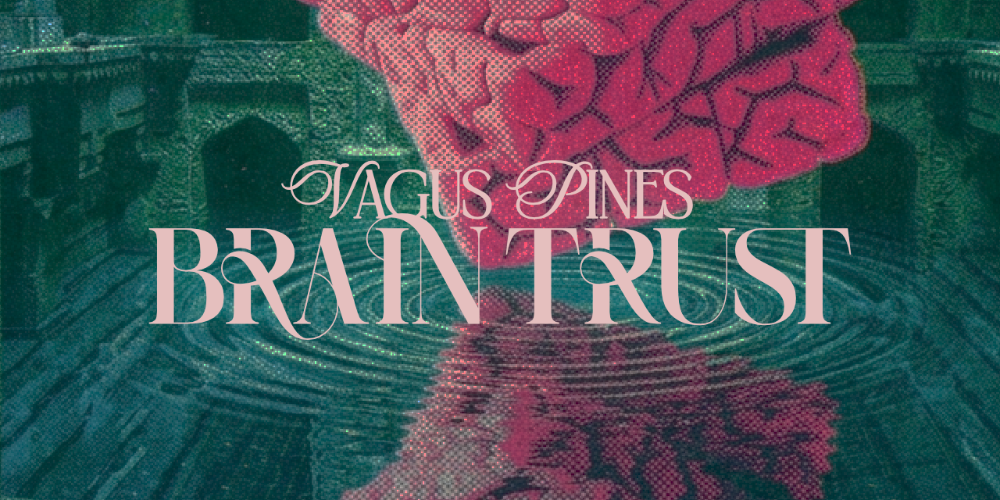

# Vagus Pines

An open protocol for gold-backed art certificates, cooperative governance, and art-secured lending.

## What this is

A framework for artist cooperatives to issue gold certificates paired with artwork, track provenance on-chain, enforce reproduction rights, and enable art-secured loans through credit union partnerships.

This is not software yet. It is a specification for a system that could be built — part manifesto, part engineering spec. The ideas originate from conversations between [Ryan Wright](https://github.com) (artistic vision, cooperative economics) and [Alex Kugell](https://ak68a.co) (financial infrastructure, technical architecture).

The full writeup lives at [LedgerDrift](https://ledgerdrift.com/engineering/gold-certificate-cooperative-architecture).

## Core concepts

**Three instruments, not one.** Gold certificates (collectibles paired with artwork), gold scrip (circulates internally), and gold currency (Goldbacks for daily transactions). Each has different regulatory treatment, user behavior, and engineering requirements.

**Usage rights as economic value.** Artists control reproduction limits per medium. Every reproduction consumes from a shared supply. The cooperative enforces limits on-chain.

**Track, don't tokenize.** The blockchain tracks serial numbers and provenance. It does not tokenize the physical certificate. Ownership is physical possession; the chain is the audit trail.

**Art-secured loans.** Gold content creates a floor value that makes loans underwritable at 60-70% LTV regardless of artist reputation. Currently a $30B market available only to ultra-high-net-worth individuals.

**Federated cooperatives.** Multiple cooperatives share the same blockchain layer. Local autonomy, shared infrastructure. Like credit unions — each one operates independently, all conform to the same standards.

## Architecture

- **Blockchain:** [Saito](https://saito.io) — Proof of Transaction consensus, transient blockchain with epoch pruning
- **Certificate tracking:** Serial number lifecycle (manufactured → minted → assigned → transferred → redeemed)
- **Reproduction control:** Atomic reserve/fulfill/confirm flow with timeout safety net
- **Governance:** On-chain proposals and voting with epoch-aware persistence
- **Fulfillment:** Drop-shipping integration (Picturum API) with cooperative-controlled limits
- **Financial layer:** Credit union partnerships for storage, exchange, and art-secured lending

## Repository structure

```
spec/               Certificate format, serial numbering, reproduction rights schema
diagrams/           Architecture and flow diagrams
CONTRIBUTING.md     How to participate
```

## Status

Early stage. The specification is being developed in public. No code exists yet — the repo is a coordination point, not a product.

## Contributing

See [CONTRIBUTING.md](CONTRIBUTING.md).

## Related

- [What Happens When You Make Gold Spendable](https://ledgerdrift.com/analysis/goldback-alternative-currency-deep-dive) — Deep dive on the Goldback alternative currency
- [Gold Certificates, Usage Rights, and the Cooperative Stack](https://ledgerdrift.com/engineering/gold-certificate-cooperative-architecture) — Full engineering writeup
- [Saito Whitepaper](https://saito.io/saito-whitepaper.pdf) — Proof of Transaction consensus
- [Goldback](https://www.goldback.com/) — Physical gold currency infrastructure

## License

MIT
